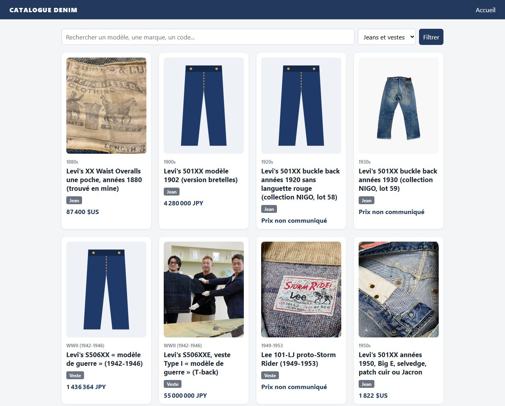
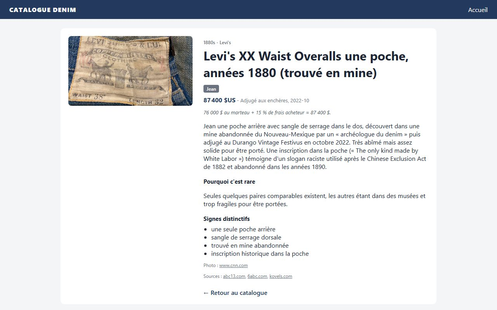
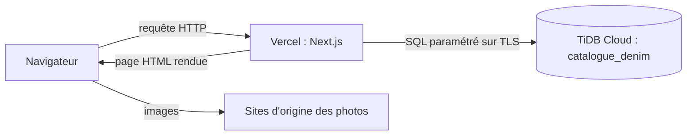
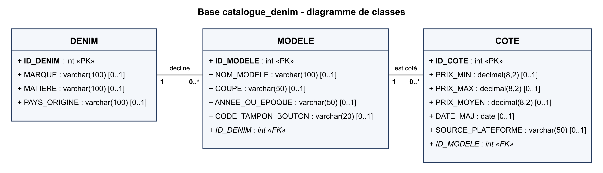

# Catalogue Denim

Catalogue en ligne de pièces de denim vintage rares et de grande valeur : jeans et vestes
Levi's, Lee et Wrangler, des années 1880 aux années 1960. Chaque pièce a sa photo, son
époque, son prix relevé (enchère, marchand, annonce) et une fiche qui explique ce qui la
rend rare, avec les sources de l'information.

## Le projet

**Objectif.** Rassembler dans une base de données des pièces de denim historiques et les
présenter dans un site simple : on parcourt la collection, on cherche un modèle, on ouvre
une fiche.

**Fonctionnalités**

- Grille de cartes : photo, époque, nom, catégorie (jean ou veste), prix dans sa devise
  d'origine.
- Recherche par nom, marque ou code modèle (« 501 », « Lee », « 11MWZ »), insensible à la
  casse, et filtre par catégorie.
- Fiche détaillée : description, raison de la rareté, signes distinctifs, type et date du
  prix, photo et sources citées.
- Image de remplacement quand une pièce n'a pas de photo ou quand le site d'origine refuse
  l'affichage de la sienne.

## Architecture

Trois couches, sans API intermédiaire :

1. **Pages (Next.js 16, App Router).** Les pages sont des composants serveur : elles
   interrogent la base pendant le rendu et envoient au navigateur du HTML déjà rempli.
   `force-dynamic` impose une lecture à chaque visite, donc une ligne ajoutée en base
   apparaît sans redéploiement.
2. **Accès aux données (`lib/db.js`).** Un pool de connexions `mysql2` ouvert en TLS (exigé
   par TiDB Cloud) et deux fonctions : `listerPieces(recherche, categorie)` et
   `trouverPiece(id)`. Toutes les valeurs passent en paramètres `?`, jamais concaténées dans
   le SQL (pas d'injection possible).
3. **Base (TiDB Cloud).** Base MySQL compatible, hébergée. Les identifiants viennent de
   variables d'environnement (`.env.local` en local, réglages du projet sur Vercel), jamais
   du code.

Seul composant exécuté dans le navigateur : `app/photo.js`, qui remplace une image
cassée.

### Fichiers

| Fichier | Rôle |
|---|---|
| `app/layout.js` | Gabarit commun : en-tête, pied de page |
| `app/page.js` | Accueil : formulaire de recherche, grille de cartes |
| `app/piece/[id]/page.js` | Fiche d'une pièce (404 si l'identifiant n'existe pas) |
| `app/photo.js` | Image avec remplacement (composant client) |
| `app/globals.css` | Styles |
| `lib/db.js` | Connexion TiDB et requêtes |
| `lib/format.js` | Formatage des prix et libellés |
| `docs/uml.md` | Diagramme UML de la base |

## Base de données

Le site lit la table **`denim_item`** : une ligne par pièce (identifiant texte, nom, marque,
catégorie, époque, description, raison de la rareté, signes distinctifs, prix, devise,
type et date du prix, photo et page d'origine, sources, indice de confiance).

La base contient aussi un **modèle relationnel** en trois tables, prévu pour suivre la cote
des modèles dans le temps : un `DENIM` (marque, matière, pays d'origine) se décline en
plusieurs `MODELE` (nom, coupe, époque, code tampon du bouton), et chaque modèle reçoit
plusieurs `COTE` (prix minimum, maximum, moyen, date, plateforme).

Détail et version texte : [docs/uml.md](docs/uml.md).

## Photos et sources

Les photos restent hébergées sur leur site d'origine (presse, maisons de vente,
marchands) : le site ne les copie pas, il les affiche et cite la page source sur chaque
fiche, ainsi que les sources du prix et de la description. Une fiche précise quand la photo
montre une pièce comparable et non l'exemplaire exact.

## Technologies

Next.js 16 et React 19 (JavaScript), `mysql2`, TiDB Cloud, hébergement Vercel. Une seule
dépendance en plus de Next.js et React.

## Lancer le projet

`npm install`, puis un fichier `.env.local` (ignoré par git) avec `TIDB_HOST`, `TIDB_PORT`,
`TIDB_USER`, `TIDB_PASSWORD`, `TIDB_DATABASE`, puis `npm run dev`. Sur Vercel, les mêmes
variables sont dans les réglages du projet ; chaque push sur `main` redéploie le site.
