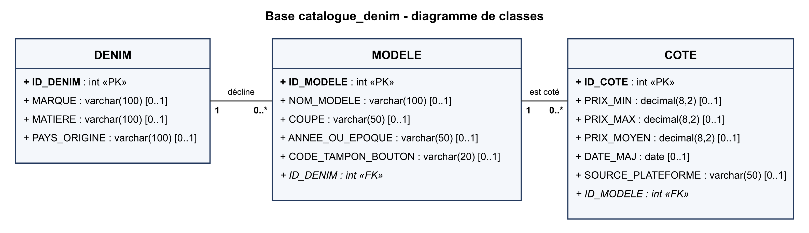
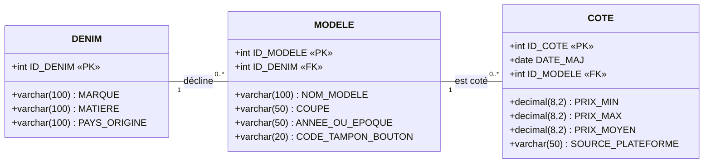

# Diagramme UML de la base `catalogue_denim`

Diagramme de classes des tables `DENIM`, `MODELE` et `COTE`, relevé sur la base TiDB
(`SHOW CREATE TABLE`, 10/11/2026).

Version vectorielle : [uml.svg](uml.svg).

Version texte (Mermaid, affichée par GitHub) :

## Lecture

- Un **DENIM** (une marque et sa toile : matière, pays d'origine) se décline en zéro ou
  plusieurs **MODELE**. Chaque modèle appartient à un seul denim : clé étrangère
  `MODELE.ID_DENIM` (`FK_MODELE`), obligatoire (`NOT NULL`).
- Un **MODELE** a zéro ou plusieurs **COTE** (prix minimum, maximum et moyen relevés à une
  date sur une plateforme). Chaque cote porte sur un seul modèle : clé étrangère
  `COTE.ID_MODELE` (`FK_COTE`), obligatoire.
- Les clés primaires (`ID_*`) sont des entiers non auto-incrémentés : l'application fournit
  l'identifiant. Les autres colonnes acceptent `NULL` (multiplicité `[0..1]` sur le dessin).
